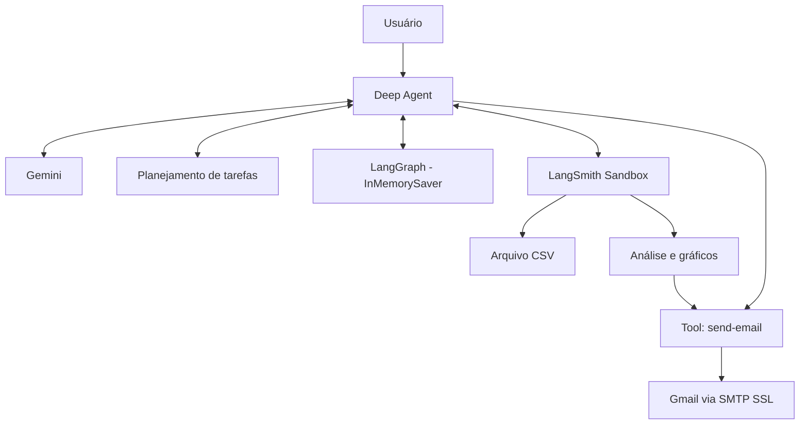

# Data Analysis Agent


Agente de Inteligência Artificial voltado à automação de análises de dados, geração de visualizações e distribuição de resultados por e-mail. Desenvolvido com Python e o ecossistema LangChain, o projeto explora a integração entre modelos de linguagem, ferramentas personalizadas e ambientes isolados de execução de código.

## Visão geral

O projeto busca reduzir o trabalho manual envolvido na análise exploratória de dados e na comunicação de resultados. A partir de uma instrução em linguagem natural, o agente pode planejar tarefas, acessar arquivos CSV, executar código, produzir gráficos e encaminhar suas conclusões por e-mail.

O protótipo utiliza dados fictícios de vendas para demonstrar esse fluxo de ponta a ponta, reunindo conceitos de Ciência de Dados, Engenharia de Agentes de IA e automação de processos.

## Funcionalidades

- Interpretação de solicitações em linguagem natural com Gemini.
- Planejamento de tarefas com `TodoListMiddleware`.
- Carregamento e análise de arquivos CSV em uma sandbox remota.
- Execução de código e geração de gráficos pelo agente.
- Extração de indicadores e insights a partir dos dados.
- Envio de análises por Gmail, com anexos opcionais.
- Persistência temporária do estado da conversa com `InMemorySaver`.
- Acompanhamento da execução por streaming de eventos e tracing configurável no LangSmith.

## Arquitetura



A arquitetura separa a tomada de decisão do agente, a execução de código e o envio dos resultados. A sandbox permite trabalhar com arquivos e comandos em um ambiente remoto, em vez de executar essas operações diretamente na máquina do usuário. A ferramenta de e-mail é executada pelo código Python do notebook, fora da sandbox.

## Tecnologias utilizadas

| Tecnologia | Responsabilidade |
|---|---|
| Python | Implementação e integração dos componentes |
| Deep Agents | Criação e orquestração do agente |
| LangChain | Ferramentas personalizadas e integração com o modelo |
| LangGraph | Gerenciamento do estado e checkpoints em memória |
| Google Gemini | Modelo de linguagem utilizado pelo agente |
| LangSmith Sandbox | Ambiente remoto para execução de código e manipulação de arquivos |
| LangSmith | Observabilidade e tracing |
| SMTP / Gmail | Envio de mensagens e anexos via conexão SSL |
| Google Colab | Ambiente de execução do notebook |

## Estrutura do projeto

```text
data-analisys-agent/
├── notebook/
│   └── Data Analysis Agent.ipynb
├── .env.example
├── .gitignore
└── README.md
```

## Como executar

### Pré-requisitos

- Conta no Google Colab.
- Chave de API do Google Gemini.
- Chave de API do LangSmith e acesso ao serviço de sandbox.
- Conta Gmail com autenticação SMTP disponível (por exemplo, senha de aplicativo, quando permitida pela conta).

### 1. Instale as dependências

Abra o notebook `notebook/Data Analysis Agent.ipynb` no Google Colab e execute a célula de instalação existente:

```python
!pip install deepagents langsmith slack-sdk langchain-core langchain_groq langchain-google-genai
```

O notebook também contém imports de Slack e Groq, mas esses serviços não são utilizados no fluxo principal, que utiliza Gemini e Gmail. As versões das dependências ainda não estão fixadas.

### 2. Configure as credenciais

Adicione os seguintes valores na seção **Secrets** do Google Colab e habilite o acesso do notebook a eles:

| Variável | Finalidade |
|---|---|
| `LANGSMITH_TRACING` | Habilitar tracing (`true`) |
| `LANGSMITH_API_KEY` | Autenticar no LangSmith |
| `GOOGLE_API_KEY` | Autenticar na API do Gemini |
| `GMAIL_EMAIL` | Endereço de e-mail do remetente |
| `GMAIL_PASSWORD` | Credencial de autenticação SMTP |

O arquivo `.env.example` documenta essas variáveis. O notebook atual lê os valores por `google.colab.userdata`, não diretamente de um arquivo `.env`.

Nunca publique credenciais reais no repositório. Confirme também a disponibilidade do identificador de modelo `gemini-3.5-flash-lite`, configurado no notebook, para sua conta e versão da integração.

### 3. Execute o notebook

Execute as células na ordem apresentada para criar a sandbox, gerar e carregar os dados de exemplo, registrar a ferramenta de e-mail, inicializar o agente e enviar a solicitação de análise.

## Exemplo de utilização

```text
Analise ./data/sales_data.csv no diretório atual e gere um gráfico bonito.
Quando terminar, envie sua análise e o gráfico para o Gmail usando a ferramenta.
```

O conjunto de dados de demonstração contém cinco registros de vendas, com as colunas `Date`, `Product`, `Units Sold` e `Revenue`. Ele é criado no próprio notebook e enviado à sandbox em `/root/data/sales_data.csv`.

Indicadores calculáveis a partir dos dados de exemplo:

| Indicador | Valor |
|---|---:|
| Receita total | 840 unidades monetárias |
| Unidades vendidas | 33 |
| Produtos distintos | 3 |
| Período | 01/08/2025 a 05/08/2025 |

Espera-se que o agente produza uma análise textual, gere uma visualização e encaminhe ambos por e-mail. O conteúdo e a apresentação podem variar conforme a execução do modelo.

## Ferramenta personalizada: send-email

A ferramenta `send-email` foi implementada com o decorator `@tool` do LangChain, permitindo que o agente solicite o envio de resultados.

| Parâmetro | Descrição |
|---|---|
| `subject` | Assunto da mensagem |
| `content` | Conteúdo textual da análise |
| `file_path` | Caminho opcional do anexo na sandbox |

Quando um anexo é informado, a ferramenta recupera o arquivo da sandbox, identifica seu tipo MIME e o adiciona à mensagem. O envio é realizado via `SMTP_SSL`, utilizando a porta 465 do Gmail. Na implementação atual, o destinatário é o próprio remetente configurado.

## Conceitos de engenharia aplicados

- **Tool calling:** integração do modelo com funcionalidades externas.
- **Agentic workflows:** decomposição e execução de tarefas orientadas a objetivos.
- **Sandboxing:** isolamento do ambiente de execução de código.
- **Checkpointing:** manutenção temporária do estado por thread.
- **Observabilidade:** acompanhamento de eventos e configuração de tracing.
- **Automação de dados:** integração entre análise, visualização e comunicação de resultados.

## Próximos passos

- [ ] Permitir o carregamento de conjuntos de dados personalizados.
- [ ] Adicionar validação automática dos resultados analíticos.
- [ ] Implementar testes automatizados para as ferramentas.
- [ ] Fixar versões das dependências e organizar a aplicação em módulos.
- [ ] Adicionar tratamento de falhas, controle de custos e encerramento da sandbox.
- [ ] Implementar aprovação humana antes de envios externos.
- [ ] Desenvolver uma interface para interação com o agente.

## Status do projeto

Protótipo experimental desenvolvido em notebook, destinado ao estudo e à demonstração de Engenharia de Agentes de IA aplicada à análise de dados. Não constitui uma solução pronta para produção. A execução depende das credenciais, da disponibilidade dos serviços externos e da compatibilidade das bibliotecas.

## Documentação de referência

- [LangChain e Deep Agents](https://docs.langchain.com/)
- [LangSmith](https://smith.langchain.com/)
- [Google Gemini API](https://ai.google.dev/)
- [Python](https://docs.python.org/3/)

